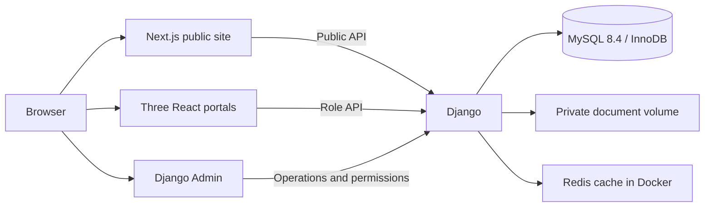
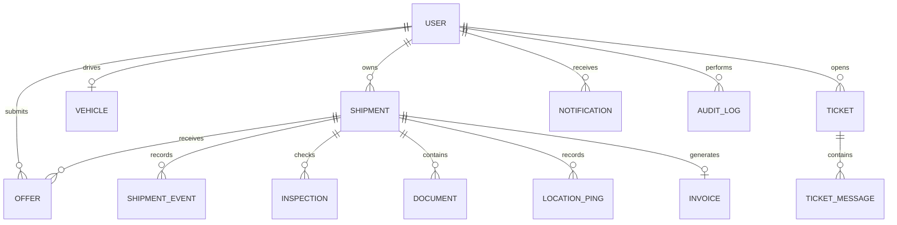
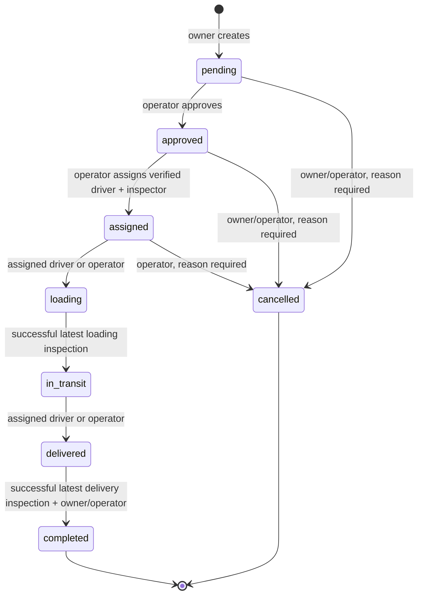

# Architecture

The public Next.js site, three independently built React portals and Django management console share one Django backend and MySQL database. The public site forwards only its public API endpoints. Each portal has a distinct origin, session cookie and PWA installation identity. Django validates private mutations and enforces domain rules within transactions.

## Repository structure

| Directory | Responsibility |
| --- | --- |
| `frontend/apps/site` | Next.js application with public pages, SEO metadata and public API forwarding |
| `frontend/apps/{driver,owner,inspector}` | Independent Vite packages and build outputs for the three portals |
| `frontend/platform` | Shared React entry, navigation and PWA build |
| `frontend/shared` | UI and forms, workspace views, styles and source assets |
| `frontend/shared/components/panels` | Typed dashboard, shipment, finance, support, reports, account and operations views |
| `frontend/shared/lib/api.ts` | Typed contracts, Persian formatting, fetch/CSRF/error handling |
| `frontend/tests` | Role-based HTTP journeys, public page checks and mobile browser tests |
| `backend/config` | Settings, URLs, WSGI entry point |
| `backend/logistics/models.py` | Persistent domain model and database constraints |
| `backend/logistics/services.py` | Locked state transitions, assignment, notifications, audit |
| `backend/logistics/serializers.py` | Validation, field-level permissions, response contracts |
| `backend/logistics/views.py` | Role-scoped queries and API actions |
| `backend/logistics/schema.py` | Explicit OpenAPI request/response shapes |
| `backend/logistics/tests` | Business, auth, object-boundary and MySQL concurrency tests |
| `scripts` | Local bootstrap, build, start, stop and verification |
| `infra`, `compose.yaml` | TLS proxy example and full-stack container deployment |

## Domain relationships

## Freight state machine

`completed` creates one invoice using a database `OneToOneField`. Transitions lock the shipment with `select_for_update()` and validate the current state after acquiring the lock. Assignment locks both the shipment and the driver, then checks vehicle type/capacity/availability, verified account and active assignments. This prevents two simultaneous dispatchers booking the same driver. Payments lock the invoice, reject duplicate references and overpayment, and settle only after the full balance is recorded. Latest inspections are authoritative, including a later failed inspection.

Money is an integer in **toman**; weight is a decimal in **metric tons**. There is no currency conversion or rial inference. Dates are stored as ISO dates/UTC timestamps and displayed in Persian using `Intl`.

## Access boundaries

| Resource | Owner | Driver | Operator | Inspector |
| --- | --- | --- | --- | --- |
| Shipments | Owned | Assigned + redacted approved market | All | Assigned |
| Private addresses/recipient | Owned | Assigned only | All | Assigned |
| Offers | On owned shipments | Own offers only | All | On assigned shipment |
| Inspection write | No | No | No | Assigned, appropriate stage |
| GPS write | No | Assigned, in transit only | No | No |
| Documents | Owned | Assigned only | All | Assigned |
| Invoices | Owned | Assigned | All / settle | None |
| Tickets | Own | Own | All | Own |
| Profile role/verified | Read-only | Read-only | Verification action only | Read-only |
| Users/audit/contacts | No | No | Yes | No |

Anonymous tracking exposes only code, cities, status and updated time. Random production tracking codes have no sequential database ID. Public registration cannot create an operator or inspector. Shipments have no physical deletion endpoint; saved-address deletion is scoped to its owner.

## Authentication and file security

HTTP-only session cookies, same-origin requests and a fresh CSRF token before mutations are used. Anonymous login and registration explicitly enforce CSRF. Production cookies are secure when `DJANGO_DEBUG=0`. Passwords use Django hashing and validators. Rate limits are backed by Redis in Compose; local development uses process memory. Proxy-level login throttling is included for production.

Uploads use random UUID filenames, a 10 MiB limit and PDF/JPEG/PNG signatures/extensions. Files are outside the public web tree and downloaded as attachments only after an ownership query. They are not antivirus-scanned; a scanning service is a documented production integration. CSV export prefixes cells beginning with spreadsheet formula characters.

The application records audit events for authentication, account/verification changes, freight transitions, offers, documents and settlement. Database administrators retain technical access; these application logs are not immutable regulatory audit storage.

## Runtime decisions

- Next.js proxies `/api` with trailing slash preservation. `skipTrailingSlashRedirect` prevents a redirect loop with Django's `APPEND_SLASH`.
- `API_INTERNAL_URL` is consumed during the Next.js build. Rebuild when changing the backend address.
- Private uploaded files must never be served by an unprotected nginx alias.
- The visual route illustration on the dashboard is a **workflow schematic**, not fabricated geographic tracking.
- Driver-initiated browser location watches send while the trip page remains open. Measurement time is separate from receive time; stale fixes cannot appear fresh. No background tracking, ETA model or route deviation service is implied.
- Sites hosting runs Workers and cannot execute this Django/MySQL stack. Delivery is the actual local full-stack project plus a standard server/container deployment path.

## Additional operational models

DriverProfile and DriverCredential implement draft/submitted/approved/rejected onboarding. Four required documents, valid dates, vehicle details and profile validation gate submission. Submission locks matching national-ID claims; review and driver/vehicle changes lock the user row. Offers and assignment check current approval and expiry. Documents use private authenticated downloads and structural image/PDF checks.

Lead, CRMActivity and FollowUp implement customer stages, contact history, ownership and due tasks. Public contact requests create linked leads atomically. Incident is shipment-scoped; open critical incidents block movement/completion until an operator records a resolution. SavedAddress is user-scoped and feeds the shipment form. PaymentRecord supports invoice partial payments under an invoice lock.

Operator capabilities are checked by DRF RolePermission and reflected in navigation. AccountSecurity stores encrypted TOTP seeds with replay counters. OutboundEmail encrypts recovery content, uses leased delivery/retry and clears payload after delivery. Recovery does not disable MFA. SECURITY_ENCRYPTION_KEY must survive session-secret rotation and database restoration.

Private API responses have no-store/noindex headers and request IDs. The client normalizes Persian digits and converts Persian calendar dates to ISO. Server date and authorization validation remain authoritative. See OPERATIONS_V2.fa.md for operational limits.

## Role PWAs and public publishing

Each role has a distinct manifest id/scope/start URL and icon set. /{panel}/app embeds role-specific login and the workspace; old panel roots redirect there. All apps deliberately retain the same origin/session security model. The Service Worker has a narrow role scope and an explicit public-asset allowlist. Navigation stays network-only with a generic offline fallback; API, RSC, private HTML, documents and mutations never enter its cache. Static framework assets are retained only with immutable headers, avoiding stale development chunks. Cache cleanup is role-local and bounded. Worker source is stamped with a public build release ID and served with no-store plus Service-Worker-Allowed; update activation is user initiated.

Article stores plain text and draft/published state. Public queries filter by status and publication time. Editorial routes require content permission. Next.js renders escaped paragraphs/headings and Article metadata, with no HTML execution. /sitemap.xml includes published guides. Public content uses server-side reads with timeouts and explicit unavailable states. Shared public navigation connects the information, help and installation pages.

The frontend API layer distinguishes authentication, access, validation, not-found, rate-limit, server, invalid-response and network/timeout failures. Main workspace reads ignore stale responses after route changes. Independent panels receive a refresh event. React boundaries isolate unexpected rendering failures; writes remain explicit and are not automatically retried.
